# CryptoCraft

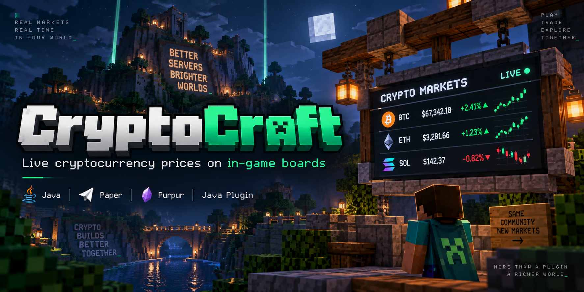

CryptoCraft displays cryptocurrency prices and history on floating map boards above ordinary Minecraft blocks. Players can trade coins with server money through admin-approved computer terminals. Boards, alerts, and trading use the same external price source. Targets Spigot, Paper, and Purpur 26.3 on Java 25.

The anchor stays a normal vanilla block. Boards show the last cached price, price history, and whether the quote is stale. Breaking the anchor removes the display and frees its owner's board slot.

[](https://github.com/furany/CryptoCraft/actions/workflows/build.yml)

## Download

Published releases are available on [Modrinth](https://modrinth.com/plugin/cryptocraft-furany) and [GitHub Releases](https://github.com/furany/CryptoCraft/releases/latest). Place the JAR in your server's `plugins` directory and restart the server. This source tree builds version 1.2.0; see the [changelog](CHANGELOG.md) and [trading setup and migration guide](docs/TRADING.md).

## Features

- **Customizable charts:** three themes, chart/price/compact views, 1-168 hour windows, optional high/low values, and square walls of 1 x 1, 2 x 2, or 3 x 3 maps.
- **Market boards and computer terminals:** up to six coins in a common currency, default 2 x 2 market screens, and vanilla display-entity housing, stand, and keyboard. No resource pack required.
- **Server-money trading:** optional Vault economy integration, budget or quantity buys, quantity or percentage sells, confirmations, depot, orders, and trade history. Choose an unlimited broker, funded reserve broker, or player-to-player matching at external prices.
- **Durable economy ledger:** SQLite reservations and journal, offline execution, expiry/cancellation, strict provider timestamps, and explicit reconciliation for uncertain Vault transfers.
- **Board menu and editor:** manage your boards, change coin/currency, height and facing, rename displays, and confirm removals in game.
- **Watchlists and comparisons:** follow configured pairs and compare their percentage changes over a selected time window.
- **Price alerts and redstone:** one-shot or repeating alerts, queued offline notifications, and optional signals through an existing lever.
- **Optional paper trading:** virtual cash, holdings, trade history, and profit tracking when enabled by the server owner.
- **Optional integrations:** WorldGuard protection and PlaceholderAPI values for scoreboards or other plugins.
- **Server controls:** board limits, Bukkit permissions, English/German messages, API backoff, freshness indicators, and recoverable data backups.

## In-game screenshots

CryptoCraft 1.2.0, captured in Minecraft 26.3 on a local Paper 26.3 server on November 2, 2026. These are unmodified 1920 × 1080 Minecraft F2 screenshots, without a resource pack or shaders. Prices, chart history, and account balances were controlled demo data; these images demonstrate the interface, not live market prices.

### Computer terminals in three sizes

The same six-coin market fits 1 × 1, 2 × 2, and 3 × 3 map screens, with vanilla display-entity housing, stands, and keyboards.

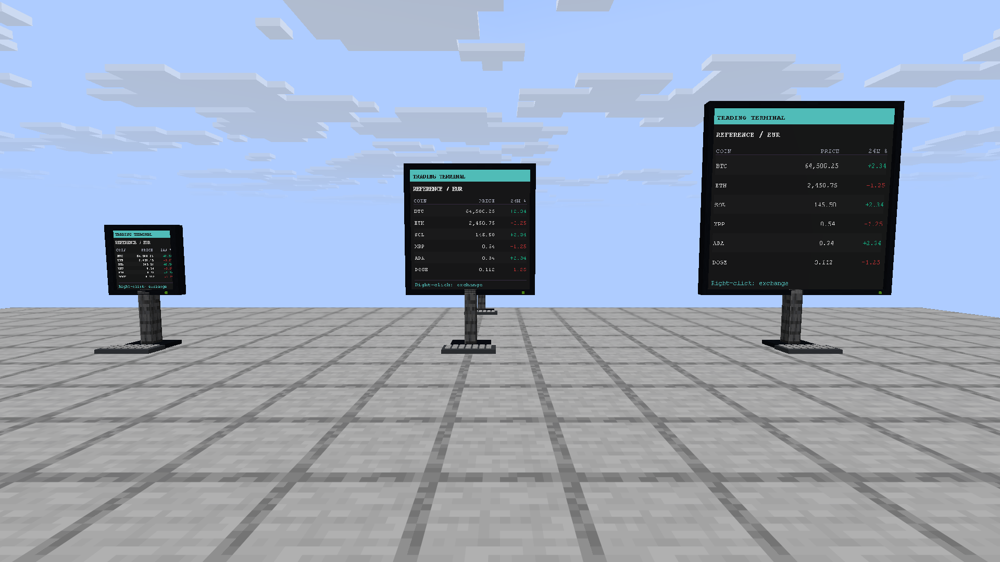

### Bitcoin chart terminal

A single-coin terminal shows its reference price, chart, and range, with a right-click shortcut to the exchange.

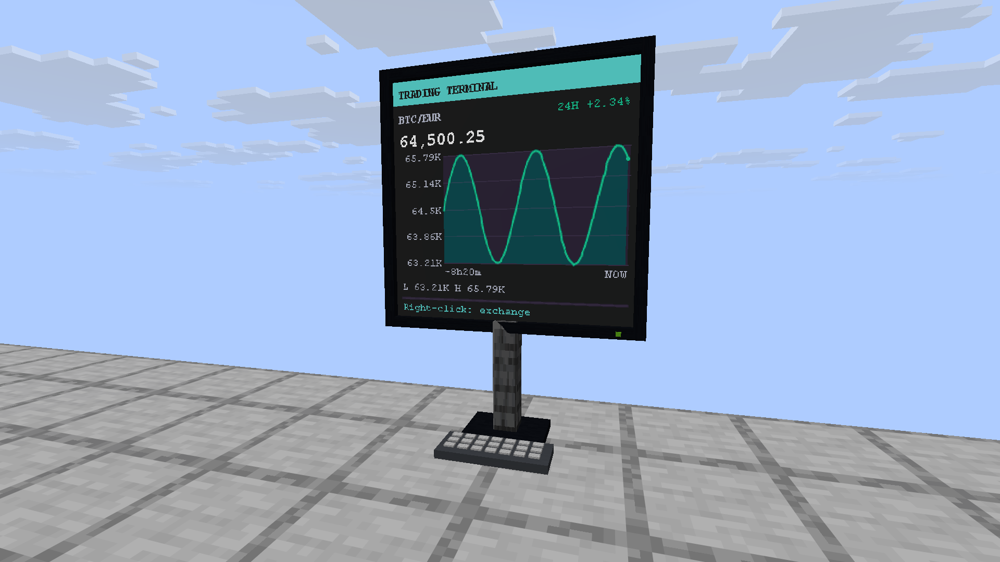

### Confirm a trade

The confirmation shows the reference price and age, estimated quantity and fee, maximum debit, and execution price guard.

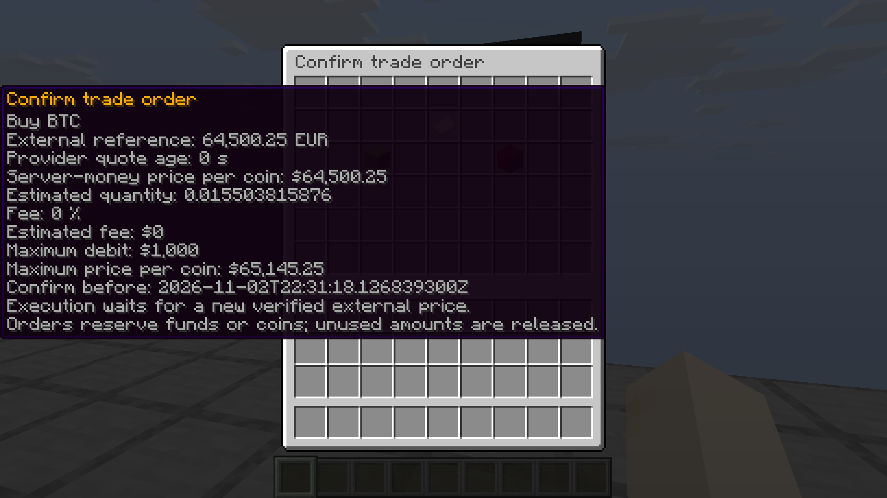

### Server-money depot

The depot shows available and reserved coins and their estimated reference value. These demo holdings include seeded test coins.

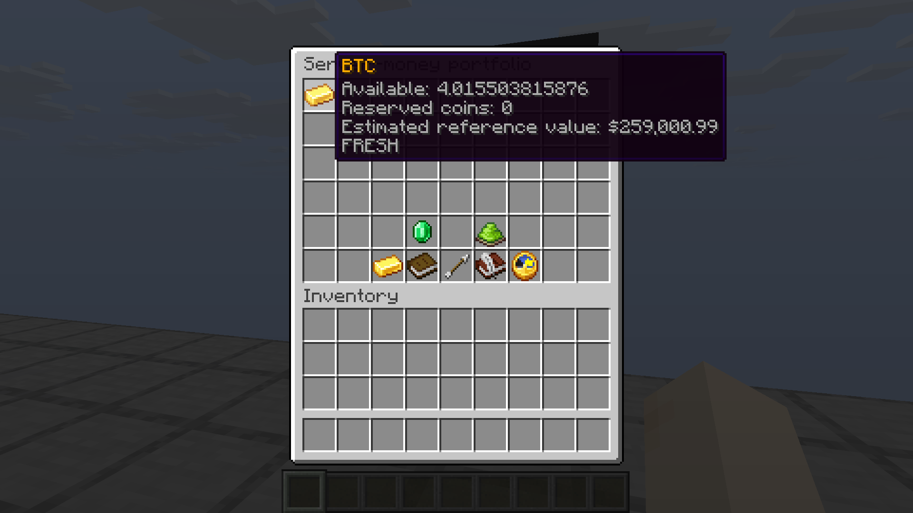

[View all six 1.2.0 screenshots and English/German gallery captions](screenshots/v1.2.0/README.md), including the market-terminal close-up and filled-order status. The gallery includes the original PNG files and captions for reuse.

<details>
<summary>Archived screenshots from version 1.1.0</summary>

These older screenshots show version 1.1.0 on Minecraft 26.3, captured on October 7, 2026. The 1.2.0 menus and terminal models have changed.

### Live chart overview

BTC/EUR, SOL/EUR, and ETH/EUR boards show cached prices, chart history, and the available sampling window above ordinary blocks.

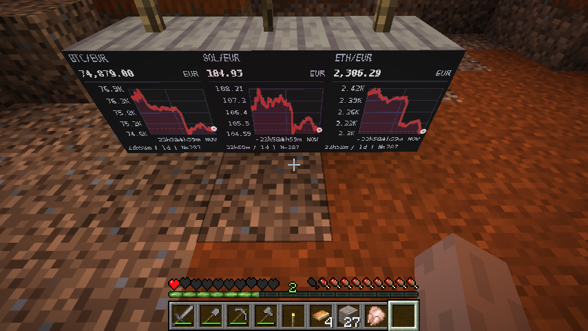

### Board menu

`/crypto menu` lists your boards and provides shortcuts to watchlists, price alerts, and the virtual portfolio.

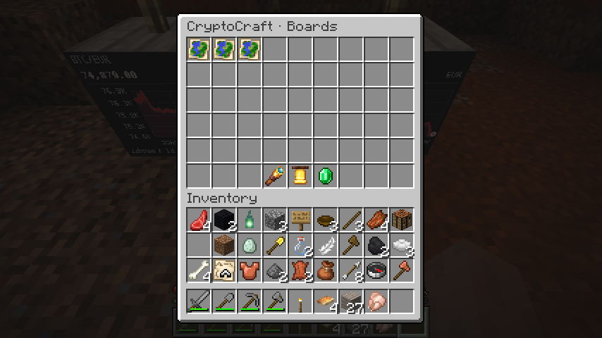

### Board editor and wall size

Click a board to open its editor. Here, the wall-size control is set to 3, producing a 3 x 3 map display.

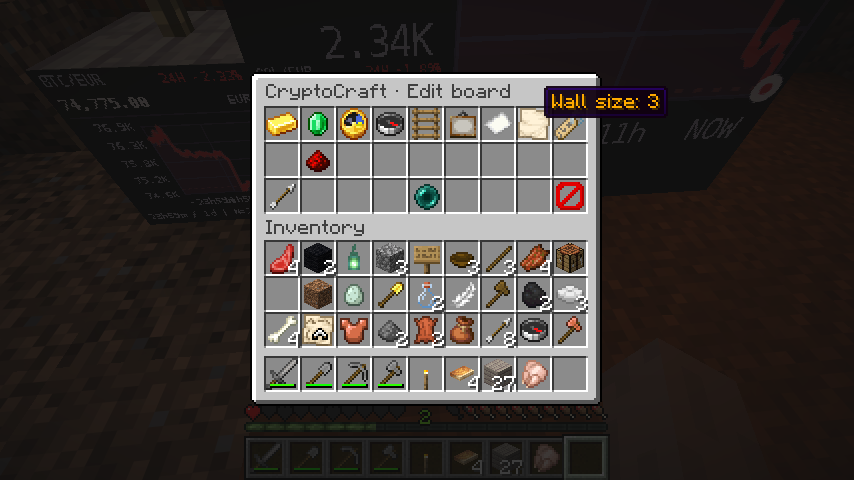

### Display height

Adjust the board's height above its anchor in the editor; the screenshot shows a height of 2.35 blocks.

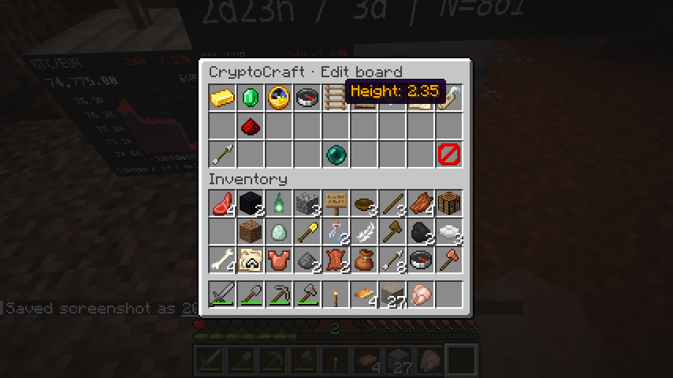

### Price-alert shortcut

The alert shortcut opens your alert list and shows the command for creating a threshold notification.

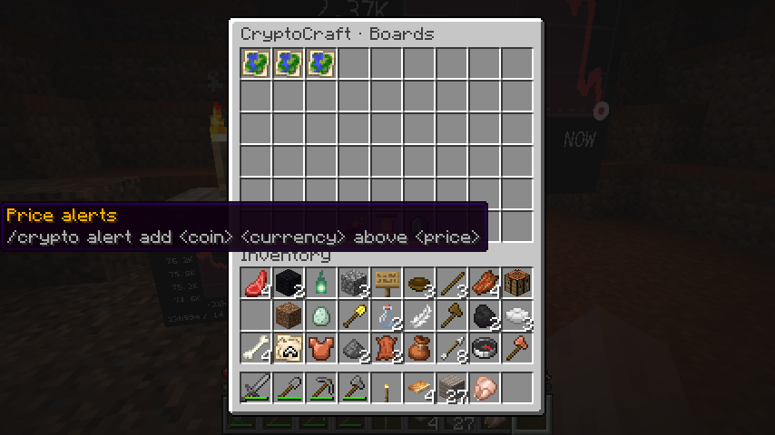

### Large chart wall

An expanded ETH/EUR wall displays the same shared price history on a larger canvas.

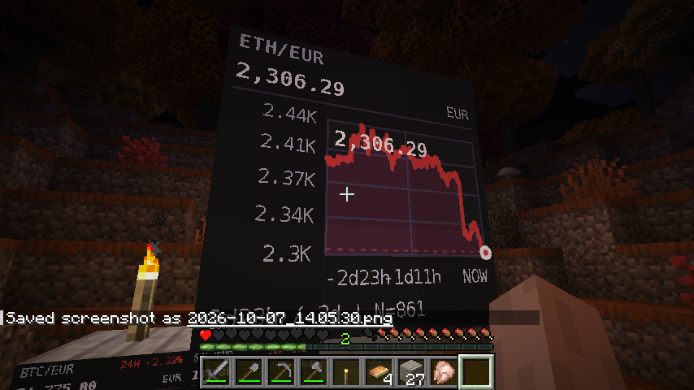

</details>

## Requirements

- Spigot, Paper, or Purpur 26.3
- Java 25
- Vault and a compatible economy provider, such as EssentialsX, for server-money trading. Charts, alerts, and paper portfolios work without them.
- The checked-in Gradle wrapper downloads the pinned Gradle version for local builds.

## Build locally

Install a Java 25 JDK, then run this from the project directory:

```sh
./gradlew clean build
```

On Windows use `gradlew.bat clean build`. The build runs the automated tests before completing. See [validation and disposable server tests](docs/TESTING.md) for the integration harness and local test evidence.

The JAR is written to `build/libs/CryptoCraft-1.2.0.jar`. SQLite and its native libraries are included. Copy it into your server's `plugins` directory and restart the server.

## Build with GitHub Actions

The workflow in `.github/workflows/build.yml` builds the JAR on every push and pull request. It can also be started manually from the repository's **Actions** tab using **Build CryptoCraft → Run workflow**.

When a workflow run finishes, open that run in **Actions**, then download the **CryptoCraft** artifact. The downloaded ZIP contains the plugin JAR.

Pushing a version tag such as `v1.0.0` starts `.github/workflows/release.yml`, which builds the plugin and attaches the JAR to a public GitHub Release.

## Use in game

Look at a vanilla block and run:

```text
/crypto place BTC EUR
```

The board appears above that block. Its normal use is unchanged. Breaking the anchor block removes the board and frees the owner's slot. `/crypto remove` removes only the floating display and leaves the block in place.

Run `/crypto` for help. `/cryptocraft` is an alias for `/crypto`.

Commands:

- `/crypto place <coin> [currency]` — place a chart above the block you are looking at. Currency is optional and defaults to EUR.
- `/crypto remove [board-id]` — remove your chart by ID or from the block you are looking at; admins can remove any chart.
- `/crypto list` — list your charts. Admins see all charts; players see their own. Players with teleport permission can click an entry to teleport.
- `/crypto menu` — open the board menu and editor.
- `/crypto market <coin,coin,...> [currency]` — create a market board with one to six coins, initially 2 x 2 maps.
- `/crypto terminal <board-id> <enable|disable>` — administratively approve or revoke a board as a trading terminal.
- `/crypto trade [coin]` — open the exchange; order acceptance normally requires a nearby terminal.
- `/crypto trade <buy|buy-quantity|sell> <coin> <amount>` — open a confirmation; `buy` uses a total budget including fees.
- `/crypto depot [history]` — inspect server-money coin holdings and executed trades from anywhere.
- `/crypto orders [cancel <id>]` — inspect or cancel orders from anywhere.
- `/crypto economy <status|reserve|grant|resolve> ...` — inspect/reconcile transfers and manage reserve funding or audited coin grants; administrative permission required.
- `/crypto coin <list|search|add|enable|disable|show|hide> ...` — manage unique provider IDs and separate display/trading availability; administrative permission required.
- `/crypto edit <board-id> <setting> <value>` — change a board's settings directly.
- `/crypto tp <board-id>` — teleport to one of your charts. Requires `cryptocraft.teleport`; admins can teleport to any chart.
- `/crypto price <coin> [currency]` — show a cached quote and its age; queue a request when needed.
- `/crypto watch <add|remove|list> [coin] [currency]` — manage your watchlist.
- `/crypto compare <coin> <coin> [currency] [hours]` — compare percentage changes and available history.
- `/crypto alert <add|remove|list> ...` — manage threshold alerts; see the examples below.
- `/crypto signal <board-id> <above|below> <price>` — link a repeating threshold rule to an existing lever.
- `/crypto portfolio [buy|sell|history] ...` — view or trade in your virtual portfolio when enabled.
- `/crypto status` — inspect API and storage health; requires the configured admin permission.
- `/crypto reload` — reload the plugin configuration and messages; requires the configured admin permission.

Tab completion suggests configured coins, currencies, and board IDs you can access.

New installations configure BTC, ETH, SOL, XRP, ADA, DOGE, LTC, BNB, AVAX, and LINK. Existing coin configurations are preserved. EUR is the default currency; EUR, USD, and TRY (Turkish lira) are available. For example, use `/crypto place BTC USD` for the Bitcoin price in US dollars or `/crypto place BTC TRY` for Turkish lira. Boards, watchlists, alerts, trading orders, virtual holdings, and temporary command requests share batched price requests subject to the global minimum interval.

For server-money trading, install Vault plus an economy provider, create a board, then run `/crypto terminal <board-id> enable` as an operator. Right-click its screen to trade. The default broker is unlimited, with EUR reference prices, factor 1, zero fees, a 1% price guard, five-minute orders, and a six-block terminal radius. A preview is not an executable quote: the order waits for a newer, verified provider timestamp. See [the trading guide](docs/TRADING.md) for modes, budgets, permissions, recovery, and all defaults.

## Configuration

Edit `plugins/CryptoCraft/config.yml`, then run `/crypto reload`.

```yaml
prices:
  refresh-interval-seconds: 300
  minimum-request-interval-seconds: 60
  request-timeout-seconds: 20
  stale-after-minutes: 10
  history-retention-days: 7
  retry:
    initial-delay-seconds: 60
    maximum-delay-seconds: 3600
    access-error-initial-delay-seconds: 900
    access-error-maximum-delay-seconds: 3600

boards:
  default-limit-per-player: 1
  admin-bypass-limit: true
  admin-permission: cryptocraft.admin
  unlimited-permission: cryptocraft.limit.unlimited
  permission-limits:
    cryptocraft.limit.vip: 3
    cryptocraft.limit.elite: 5
  display-height: 1.35
  chart-history-hours: 24

api:
  url: "https://api.coingecko.com/api/v3/simple/price"
  auth-mode: demo
  demo-key: ""
  pro-key: ""
  query:
    coin-ids-parameter: ids
    currencies-parameter: vs_currencies
    include-24hr-change: true
    include-last-updated-at: true
    additional-parameters: {}

coins:
  BTC: bitcoin
  ETH: ethereum
  SOL: solana
  XRP: ripple
  ADA: cardano
  DOGE: dogecoin
  LTC: litecoin
  BNB: binancecoin
  AVAX: avalanche-2
  LINK: chainlink

currencies:
  - EUR
  - USD
  - TRY

default-currency: EUR
```

`refresh-interval-seconds` controls automatic polling. `default-currency` is used when a command omits its optional currency argument. `minimum-request-interval-seconds` is a global floor for all requests, including a refresh triggered when a board is placed. HTTP 429 retries honor `Retry-After` and use exponential backoff up to `maximum-delay-seconds`. HTTP 401/403 responses use a separate, longer backoff configured by `access-error-initial-delay-seconds` and `access-error-maximum-delay-seconds`; repeated warnings for the same status are suppressed until the status changes, the API recovers, or `/crypto reload` is run. Error details are shortened and API keys are redacted from logs.

After `stale-after-minutes` without a fresh quote, the chart replaces its 24-hour change with an orange `STALE` label and the quote age (`ALT` in German). The cached price remains visible while the API is unavailable.

Charts show the most recent history within the board’s selected window (initially `boards.chart-history-hours`). The plot uses the collected history across the full graph width while data is warming up; its footer shows collected time versus the selected window and the number of samples. The left axis labels price, the bottom axis labels time, and the shaded line highlights the recent price movement. The header shows the latest price and 24-hour change. CryptoCraft samples prices during its existing batched refreshes and retains up to `prices.history-retention-days` days in `plugins/CryptoCraft/history.yml`. Normal chart updates make no chart-specific API requests. Optional initial history imports have a separate hourly budget and also respect the global request floor and API backoff.

Set `language` in `plugins/CryptoCraft/messages.yml` to `en` or `de` to choose English or German command and chart messages. You can edit the language strings in that file and apply changes with `/crypto reload`.

Set `api.url` to a CoinGecko Simple Price compatible endpoint. The query parameter names for coin IDs and currencies, the optional 24-hour-change and update-time flags, and extra string-valued query parameters can be changed under `api.query`. Coin symbols map to CoinGecko coin IDs under `coins`; currencies are listed under `currencies`.

## Player limits and permissions

Players may place one board by default. A matching permission in `boards.permission-limits` sets that player's limit; if more than one configured permission matches, the highest matching limit applies. Players with the configured unlimited permission bypass the limit. Admins bypass it as well while `boards.admin-bypass-limit` is enabled.

LuckPerms examples:

```text
/lp group vip permission set cryptocraft.limit.vip true
/lp group elite permission set cryptocraft.limit.elite true
/lp group staff permission set cryptocraft.limit.unlimited true
/lp group admin permission set cryptocraft.admin true
/lp group admin permission set cryptocraft.teleport true
```

`cryptocraft.teleport` defaults to operators. Grant it explicitly to allow non-admin players to teleport to their own boards; players without it cannot use `/crypto tp` or clickable board entries. Admins (the permission configured at `boards.admin-permission`) can teleport to any board.

The plugin uses Bukkit permissions directly and has no dependency on LuckPerms. Vault and a compatible economy provider are optional for the plugin and required for server-money transfers. WorldGuard and PlaceholderAPI remain optional. `cryptocraft.trade` defaults to everyone; `cryptocraft.terminal.admin` and `cryptocraft.economy.admin` default to operators. Terminal changes require the terminal permission even for board owners.

## CoinGecko API

With `api.auth-mode: demo`, CryptoCraft sends `api.demo-key` using the Demo API header. If the key is empty, it uses CoinGecko's keyless Public API. For a paid plan, set `api.auth-mode: pro` and provide `api.pro-key`; the plugin uses the Pro API header and switches the default endpoint to `pro-api.coingecko.com`. A custom `api.url` is left unchanged in either mode. The plugin sends a descriptive User-Agent and logs a shortened API error response plus a request ID when available.

CoinGecko distinguishes access-denied HTTP 403 errors from HTTP 429 rate limiting. A valid Demo key may help with public API access; a 403 can also require CoinGecko to unblock the server's outbound IP. CryptoCraft keeps the last cached prices during errors.

See CoinGecko's [keyless Public API documentation](https://docs.coingecko.com/docs/keyless-public-api) for current limits and usage guidance.


## Board editing and menu

`/crypto menu` opens a paginated list of your boards (all boards for admins). Click a board to cycle its coin, currency, time window, direction, height, theme, view, wall size, and high/low footer. Renaming asks for chat input for 60 seconds; type `cancel` to cancel or `-` to clear the name. Removing a board from the menu requires a second click to confirm. Ownership, permissions, and region protection are checked again when an action runs.

You can also edit directly:

```text
/crypto edit <board-id> coin ETH
/crypto edit <market-board-id> coins BTC,ETH,SOL
/crypto edit <board-id> currency USD
/crypto edit <board-id> hours 168
/crypto edit <board-id> facing north
/crypto edit <board-id> height 2.0
/crypto edit <board-id> name My Bitcoin chart
/crypto edit <board-id> theme light
/crypto edit <board-id> style price
/crypto edit <board-id> size 3
/crypto edit <board-id> range true
/crypto remove <board-id>
```

Get IDs from `/crypto list` or tab completion. Settings accept 1–168 hours, heights from 0.5 to 8 blocks, names up to 32 printable characters, themes `dark|light|ocean`, views `chart|price|compact`, and square walls of `1|2|3` maps per side. Walls count as one board. Their bottom row starts at the configured height above the anchor; columns expand symmetrically to the sides. Unloaded neighboring chunks are not force-loaded; their tiles appear when the chunks load. Growing or rotating a wall checks the full footprint against WorldGuard.

`cryptocraft.edit` defaults to everyone, but players can only edit their own boards. Per-board settings are persisted. Legacy boards use the configured default height and history window on their first load; those defaults apply to newly created boards afterward.

## Watchlists, comparison and alerts

```text
/crypto watch add BTC EUR
/crypto watch remove BTC EUR
/crypto watch list
/crypto compare BTC ETH EUR 24
/crypto alert add BTC EUR above 70000 once
/crypto alert add ETH USD below 2000 repeat
/crypto alert list
/crypto alert remove <alert-id>
```

Watchlist currencies are optional and use `default-currency`. Comparison shows percentage change from the first available sample in the selected window and reports actual coverage and quote freshness. Alerts use inclusive thresholds (`above` means >= and `below` means <=). Repeating alerts rearm only after the quote moves to the opposite side, and respect `players.alarm-cooldown-seconds`. Old quotes never fire alerts. Up to 20 offline notifications per player are queued and delivered on login. Completed one-shot alerts remain visible until removed.

The default watchlist and alert limits are both 20, configured with `players.watchlist-limit` and `players.alarm-limit`. `cryptocraft.alert` defaults to everyone.

`/crypto price` can request configured pairs even without a board. Requests are queued through the shared polling lane; a new pair can wait for the minimum interval or an API retry delay. It displays the API timestamp, age in seconds, and freshness. English and German number formatting follow `messages.yml`.

## Redstone signals

Place a lever directly above your board's anchor, then run:

```text
/crypto signal <board-id> above 70000
/crypto signal <board-id> below 50000
```

A signal is a repeating alert linked to that board and appears in `/crypto alert list`. The existing lever stays powered while a fresh cached quote matches the threshold. Multiple rules on one board are combined with OR. Signals turn off on stale quotes, when disabled in config, when their rule/board is removed, and when the plugin stops. They resume from persisted rules when their chunk loads. The plugin does not create or replace blocks and does not load chunks to update a lever.

Signal creation requires ownership (or admin permission), `cryptocraft.signal` (operators by default), and permission to modify the lever's region. Set `players.redstone-enabled: false` to disable output.

## Virtual portfolio

Enable `portfolio.enabled: true` to allow paper trading with virtual cash:

```yaml
portfolio:
  enabled: true
  currency: EUR
  starting-cash: "10000"
```

```text
/crypto portfolio
/crypto portfolio buy BTC 0.01
/crypto portfolio sell BTC 0.005
/crypto portfolio history
```

Each player gets the configured starting balance on first use. Existing accounts keep their currency and balance when defaults change. Trades require fresh cached prices, positive quantities with at most 12 decimal places, sufficient virtual cash or holdings, and `cryptocraft.portfolio`. The ledger tracks holdings, average acquisition cost, realized profit, total value, and the last 100 trades. Valuations label missing or stale quotes as incomplete. Previously held coins can still be sold if their symbol is removed from config.

This simulation uses its own virtual cash. It never reads or modifies Vault balances, the server-money depot, or the reserve. Accounts, watchlists, alerts, and pending notifications are stored in `players.yml`. Server-money trading is a separate feature described in [the trading guide](docs/TRADING.md). Neither feature connects to real wallets or sends cryptocurrency.

## Optional history import and integrations

Enable `prices.backfill.enabled: true` to import initial history once per coin/currency pair. `prices.backfill.days` defaults to 7 and `prices.backfill.maximum-requests-per-hour` defaults to 6. The shared HTTP lane prioritizes live polling, honors the global minimum interval and `Retry-After`, and merges imported samples with locally collected samples. Completed imports are persisted across restarts. A pair whose history has expired can be imported again. Custom price providers must explicitly configure a compatible `prices.backfill.url` containing `{id}`; the default CoinGecko history URL is only derived for the standard CoinGecko price endpoints.

If WorldGuard is installed and `integrations.worldguard` is enabled, creating/editing/removing boards and linking signals respects its BUILD flag, including WorldGuard bypass permissions. A failed protection query denies the modification.

If PlaceholderAPI is installed and `integrations.placeholderapi` is enabled, the internal expansion supplies:

```text
%cryptocraft_price_BTC_EUR%
%cryptocraft_change_BTC_EUR%
%cryptocraft_age_BTC_EUR%
%cryptocraft_stale_BTC_EUR%
%cryptocraft_boards%
%cryptocraft_virtual_cash%
%cryptocraft_virtual_currency%
```

`change` is the API's 24-hour percentage change, and `age` is in seconds. Missing cached values are empty. Placeholders only read caches and never perform HTTP, disk or world operations. Enable `integrations.placeholderapi-preload` to poll all configured pairs even without boards or watchlists. Neither optional plugin is needed to run CryptoCraft.

## Administration, persistence and validation

`/crypto status` (configured admin permission) reports board count, last successful live-price request, earliest permitted next request, in-flight state, API failure state, and storage errors. Times are UTC; an epoch timestamp means no successful request in this server session.

`/crypto reload` validates both YAML files before applying changes. Invalid values reject the reload with actionable configuration paths. Old in-flight HTTP results are discarded after reload or shutdown, while cached quotes remain available. Missing new message keys fall back to the bundled translations without overwriting custom messages.

Boards are cleaned up after anchor destruction by players, explosions, or piston movement. Periodic validation catches anchors removed by external tools in loaded chunks. Displays are protected against removal, rotation, and item extraction. Teleports reject dangerous blocks, liquids, partial-height floors and positions outside the world border.

YAML data writes are coalesced on one background writer, use temporary files and atomic replacement where supported, and keep the preceding version in `.bak`. Startup can recover missing or syntactically damaged primary YAML from its backup and retains damaged input in `.damaged`. Invalid unrecoverable data stops startup instead of overwriting saved state. Shutdown flushes pending YAML writes; an abrupt crash can lose changes from the last two seconds of YAML updates.

The separate `economy.db` uses SQLite transactions for balances, reservations, orders, reserve, transfers, and journal entries. Money transfers across Vault and SQLite cannot be committed atomically together. A crash during a Vault call therefore freezes the affected account until an administrator verifies and reconciles the transfer; it is never blindly retried. Back up the complete plugin directory with the server stopped, together with the economy provider's data. See [recovery instructions](docs/TRADING.md#uncertain-transfers-and-recovery).

Chart images are computed on a separate worker from immutable snapshots, cached across matching boards, and copied to map canvases only when the image changes. Chunk/entity indexes reduce repeated searches during normal refreshes.

The tests cover price parsing, history imports, API retries, stale data, reload handling, permissions, data recovery, portfolio accounting, alerts, configuration, external-price trading, reservations, budgets, partial fills, persistence/reconciliation, terminal geometry/lifecycle, and chart rendering. Chart and six-coin market previews for 1 x 1 through 3 x 3 are in `build/chart-previews/`; test reports are in `build/reports/tests/test/`. Automated raster previews do not replace in-game visual review.
