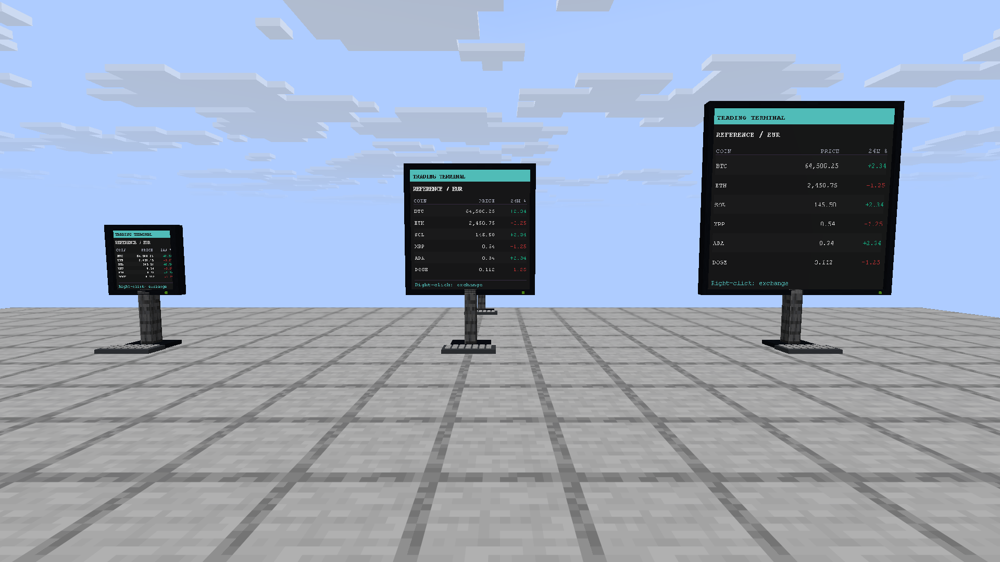
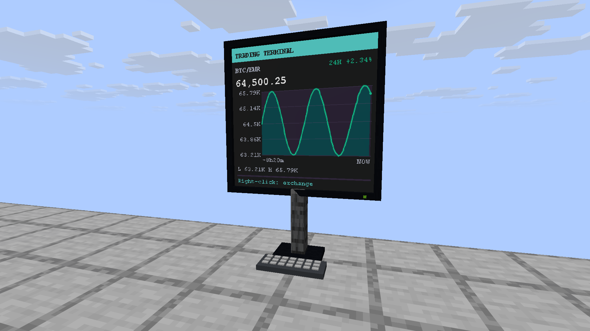
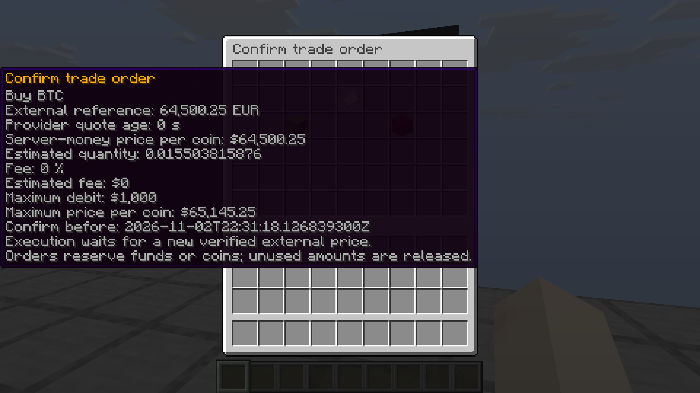
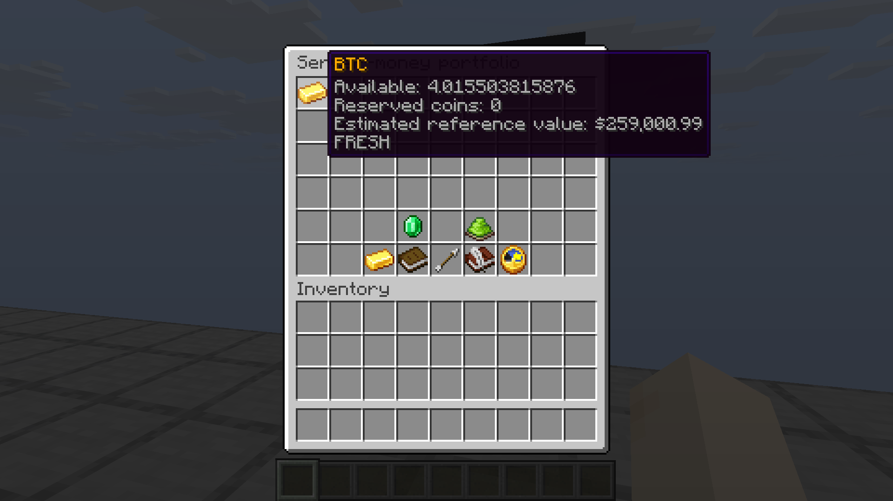

# CryptoCraft

CryptoCraft brings cryptocurrency charts and server-money trading to Minecraft. Place a chart above a normal block or build a computer terminal with a map screen, housing, stand, and keyboard. It runs on **Spigot, Paper, and Purpur 26.3 with Java 25**, without a resource pack.

Charts, alerts, and trading share the same external price source. The coins exist only inside your server: there are no real wallets or cryptocurrency transfers.

## What's new in 1.2.0

- **Server-money trading through Vault:** buy by total budget or coin quantity, sell a quantity or percentage of your holdings, and confirm the preview before submitting.
- **Three economic modes:** an unlimited server broker, a broker backed by a funded reserve, or player-to-player matching at the external reference price.
- **Computer terminals and market boards:** up to six coins on one screen, with layouts from 1 × 1 to 3 × 3 maps. Market boards start at 2 × 2.
- **Depot and orders:** inspect available/reserved coins, follow partial fills, cancel remaining orders, and view completed trades. Orders can execute while their owners are offline.
- **Durable accounting:** SQLite stores holdings, reservations, orders, reserve, and the journal. Uncertain Vault transfers require an administrative reconciliation and are not automatically repeated.
- **Ten default coins:** BTC, ETH, SOL, XRP, ADA, DOGE, LTC, BNB, AVAX, and LINK on new installations. Admins can add unique provider IDs and control display and trading availability separately.

The board editor, dark/light/ocean themes, watchlists, price alerts, redstone signals, and independent paper portfolio remain available. Menus include search, pagination, and English/German messages. WorldGuard and PlaceholderAPI integrations are optional.

## Installation and first terminal

1. Put `CryptoCraft-1.2.0.jar` in your server's `plugins` folder and restart on Java 25.
2. For server-money trading, also install **Vault and a compatible economy provider**, such as EssentialsX. Charts, watchlists, alerts, and the paper portfolio work without them.
3. Look at a block and run `/crypto market BTC,ETH,SOL EUR` or `/crypto place BTC EUR`.
4. Use `/crypto list` to find the board ID. As an administrator, run `/crypto terminal <board-id> enable`.
5. Right-click the terminal to open the exchange. Confirm an order, follow it with `/crypto orders`, and inspect holdings with `/crypto depot`.

By default, order submission requires an approved terminal within six blocks. Access is checked again at confirmation. Depot, history, orders, and cancellation work anywhere. All terminals use the same market. Removing a board's anchor removes the display; the anchor itself remains an ordinary Minecraft block.

## Prices and economic modes

Trade value is coin quantity × external reference price × the configured server-money factor. Fees are separate. A price guard protects an order from an unfavorable move; it never sets the execution price.

Every execution waits for a fresh provider timestamp after the order was accepted. Player-to-player execution needs a timestamp after both orders. Missing, stale, or unverified timestamps pause trading. Prices are polled and cached, rather than streamed tick by tick.

| Mode | How it works |
| --- | --- |
| `unlimited` | The server accepts valid orders within the configured limits and funds sales. This is the default. |
| `reserve` | Purchases add to a reserve. Sales require enough reserve; an uncovered sale is rejected and its coins released. The reserve starts at zero and admins can fund it from Vault. |
| `p2p` | Oldest executable buy/sell orders match at the external price. Partial fills keep priority. No self-trades or automatic fallback to the server broker. |

An unmatched player order waits until a match, cancellation, or expiry. Unused budget and remaining coins are released. The default settings are EUR reference prices, factor 1, zero fees, a 1% price guard, five-minute orders, a maximum quote age of 120 seconds, and 20 open orders per player. Order values default to 1–1,000,000 server-money units.

## Commands

```text
/crypto menu
/crypto market BTC,ETH,SOL EUR
/crypto terminal <board-id> enable
/crypto trade BTC
/crypto trade buy BTC 100
/crypto trade buy-quantity BTC 0.01
/crypto trade sell BTC 0.005
/crypto depot
/crypto depot history
/crypto orders
/crypto orders cancel <order-id>
/crypto watch add SOL EUR
/crypto alert add BTC EUR above 70000 once
```

`trade buy` takes a total budget including fees. `buy-quantity` opens a preview with a maximum budget for confirmation. The sell menu also offers 25%, 50%, and 100% of available holdings.

Administrators can use `/crypto economy status`, `/crypto economy reserve deposit <amount>`, and `/crypto coin search <name|symbol|provider-id>`. Add a coin with `/crypto coin add <SYMBOL> <provider-id>` and explicitly enable its trading with `/crypto coin enable <SYMBOL>`. Display and trading controls are independent. Existing commands remain available; use `/crypto` for help.

## Screenshots

These unedited 1920 × 1080 Minecraft F2 captures show CryptoCraft 1.2.0 on a local Paper 26.3 server, without a resource pack or shaders. They use controlled demo prices, chart history, and test balances; they demonstrate the interface, not live market prices.

### Computer terminals in three sizes



### Bitcoin chart terminal



### Trade confirmation



### Server-money depot



[All six screenshots and bilingual gallery captions](https://github.com/furany/CryptoCraft/blob/v1.2.0/screenshots/v1.2.0/README.md), including the market-terminal close-up and completed order.

## Configuration and upgrading

Edit `plugins/CryptoCraft/config.yml` and run `/crypto reload`. Choose `en` or `de` in `messages.yml`. Players get one board by default, with configurable permission-based limits. `cryptocraft.trade` defaults to everyone; terminal and economy administration default to operators. WorldGuard protection and existing ownership rules still apply.

The paper portfolio is enabled separately with `portfolio.enabled: true`. Its cash and holdings never mix with Vault money or the server-money depot. Optional history import uses `prices.backfill.enabled: true`. Prices come from CoinGecko or a compatible provider; requests share rate limits and retry delays. A CoinGecko Demo key can be configured.

To upgrade from 1.1.0, stop the server and back up the complete CryptoCraft directory together with your economy provider's data. Replace the JAR and restart. Existing boards, custom messages, coin configuration, and paper portfolios are retained. Existing boards remain ordinary charts until approved as terminals; the new SQLite depot starts separately.

Legacy configurations without `trading.reference-currency` inherit their valid existing `default-currency`, including USD-only setups; new installations default to EUR, and reloads without that key retain the active trading currency.

Review the economic mode, currency, conversion factor, and provider before starting server-money trading. Mode changes require no open orders or unclear transfers. Currency, factor, and money precision cannot be changed by an ordinary reload after economic activity. Disabled coins retain their holdings. If a Vault movement is uncertain after a crash or provider failure, an administrator must verify and reconcile it before the affected account resumes.

See the [full documentation](https://github.com/furany/CryptoCraft/blob/v1.2.0/README.md), [trading and recovery guide](https://github.com/furany/CryptoCraft/blob/v1.2.0/docs/TRADING.md), [changelog](https://github.com/furany/CryptoCraft/blob/v1.2.0/CHANGELOG.md), or [report an issue](https://github.com/furany/CryptoCraft/issues).
