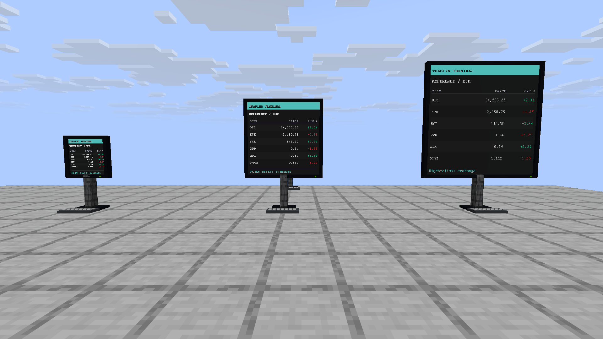
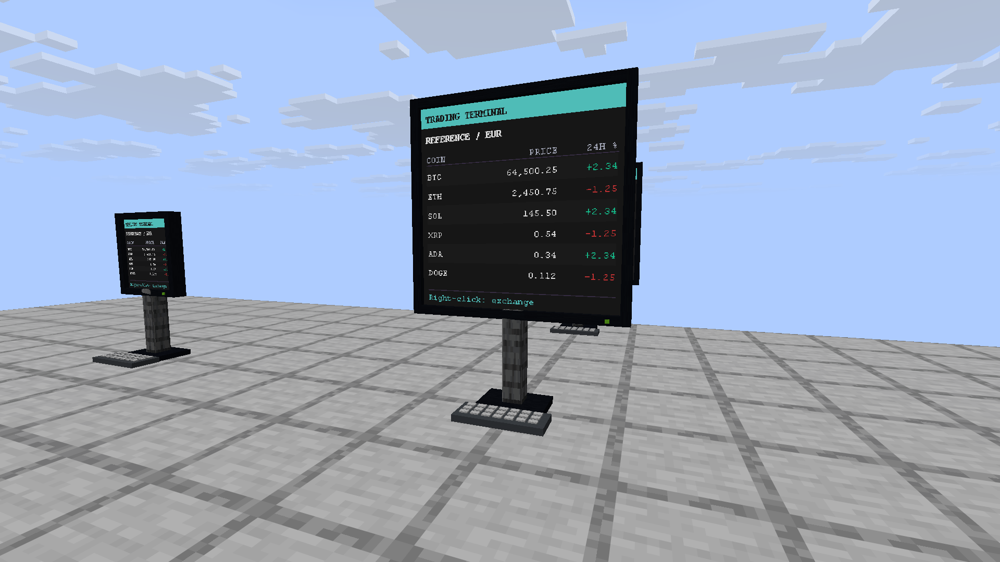
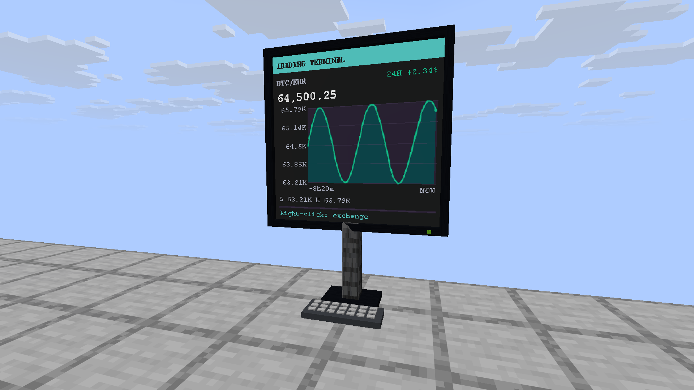
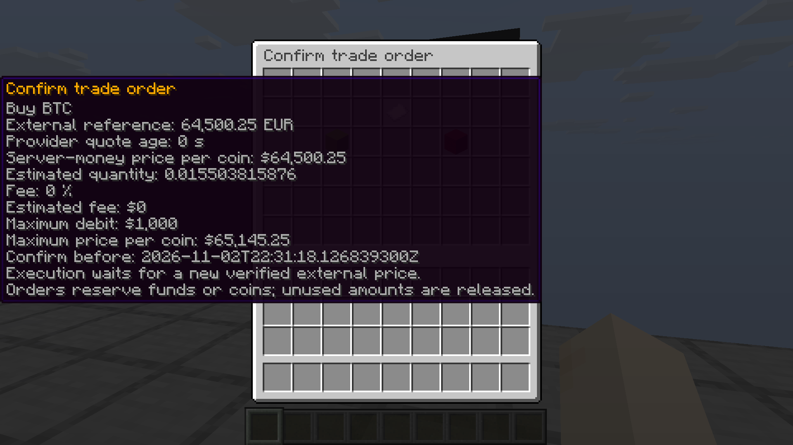
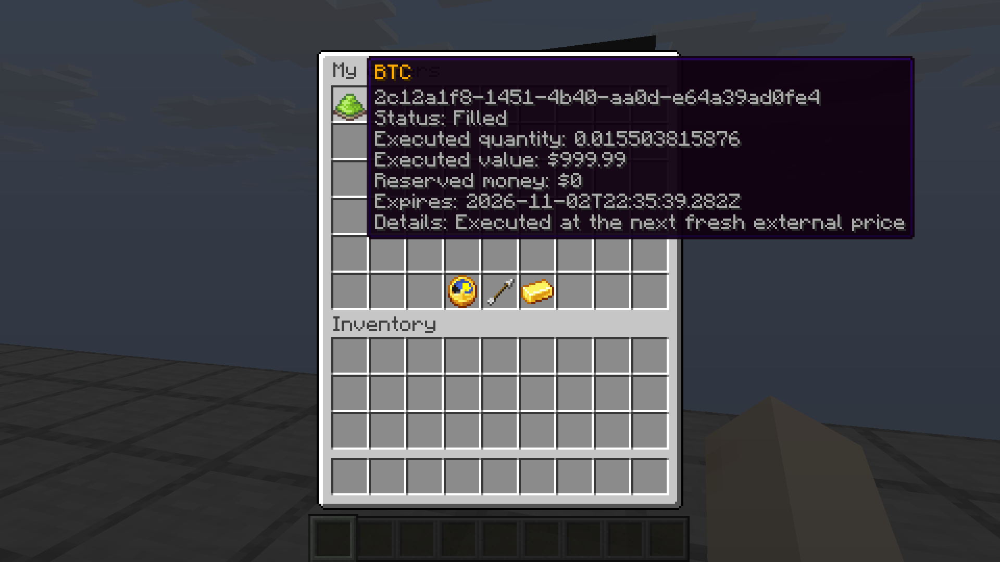
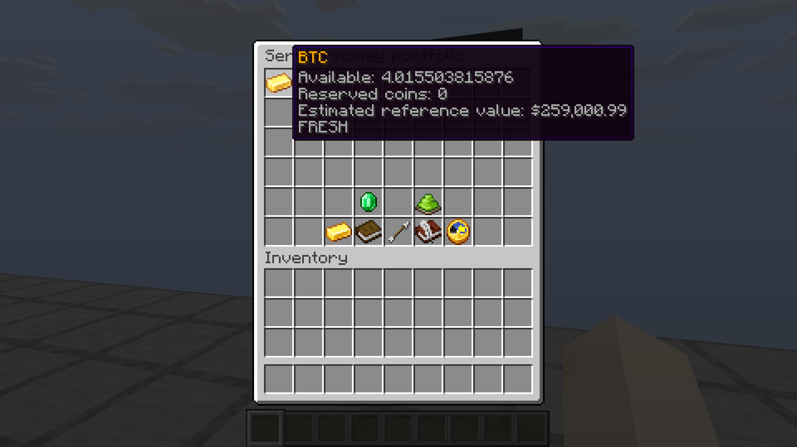

# CryptoCraft 1.2.0 screenshot gallery

Six original Minecraft F2 screenshots, captured on November 2, 2026, in Minecraft 26.3 on a local Paper 26.3 server. All images are 1920 × 1080 PNGs and were copied without cropping, retouching, overlays, or other image changes. No resource pack or shaders were used.

The screenshots use controlled demo prices, sample chart history, and seeded test balances. They show the actual plugin interface and a demo trade; they are not evidence of live cryptocurrency market prices. The server-money depot is separate from real cryptocurrency wallets and the paper portfolio.

The English/German titles and captions below accompany these files for documentation and project galleries. The media archive `CryptoCraft-1.2.0-media.zip` contains these six PNGs and this README; local builds store it in the repository's `build/` directory.

**Deutsch:** Sechs unveränderte Minecraft-F2-Aufnahmen vom 2. November 2026, aufgenommen in Minecraft 26.3 auf einem lokalen Paper-26.3-Server. Jede PNG-Datei hat 1920 × 1080 Pixel. Es wurden keine Ressourcenpakete oder Shader verwendet und keine Bilder nachbearbeitet. Die Aufnahmen zeigen kontrollierte Demo-Kurse, Beispielverläufe und vorbereitete Testguthaben; sie belegen keine Live-Marktkurse. Das Medienpaket enthält die sechs PNGs sowie diese Bildunterschriften.

## 1. Terminal sizes

**File:** [terminal-sizes.png](terminal-sizes.png)

**English title:** Computer terminals in three sizes

**English caption:** A six-coin demo market on 1 × 1, 2 × 2, and 3 × 3 map screens, with vanilla display-entity housing, stands, and keyboards. No resource pack required.

**Deutscher Titel:** Computer-Terminals in drei Größen

**Deutsche Bildunterschrift:** Ein Demo-Markt mit sechs Coins auf Kartenbildschirmen in 1 × 1, 2 × 2 und 3 × 3. Gehäuse, Standfuß und Tastatur bestehen aus Vanilla-Display-Entities; ein Ressourcenpaket ist nicht erforderlich.

## 2. Market terminal

**File:** [market-terminal.png](market-terminal.png)

**English title:** Six-coin market terminal

**English caption:** BTC, ETH, SOL, XRP, ADA, and DOGE share one EUR market screen with demo prices and 24-hour changes. Right-clicking the terminal opens the exchange.

**Deutscher Titel:** Marktterminal mit sechs Coins

**Deutsche Bildunterschrift:** BTC, ETH, SOL, XRP, ADA und DOGE teilen sich eine Marktübersicht in EUR mit Demo-Kursen und 24-Stunden-Änderungen. Ein Rechtsklick auf das Terminal öffnet die Börse.

## 3. Bitcoin chart terminal

**File:** [bitcoin-chart-terminal.png](bitcoin-chart-terminal.png)

**English title:** Bitcoin chart at the trading terminal

**English caption:** A BTC/EUR terminal shows the demo reference price, sample history, and visible price range. Its monitor, stand, and keyboard use vanilla Minecraft entities.

**Deutscher Titel:** Bitcoin-Chart am Handelsterminal

**Deutsche Bildunterschrift:** Ein BTC/EUR-Terminal zeigt den Demo-Referenzkurs, einen Beispielverlauf und die sichtbare Kursspanne. Monitor, Standfuß und Tastatur verwenden Vanilla-Minecraft-Entities.

## 4. Trade confirmation

**File:** [trade-confirmation.png](trade-confirmation.png)

**English title:** Review a buy order before confirming

**English caption:** The demo Bitcoin buy preview shows quote age, estimated quantity and fees, maximum debit, and a price guard. Execution waits for a newer verified provider timestamp.

**Deutscher Titel:** Kaufauftrag vor der Bestätigung prüfen

**Deutsche Bildunterschrift:** Die Vorschau des Bitcoin-Demokaufs zeigt Kursalter, voraussichtliche Menge und Gebühren, maximale Belastung und Preisgrenze. Die Ausführung wartet auf einen neueren bestätigten Anbieterzeitstempel.

## 5. Filled order

**File:** [filled-order.png](filled-order.png)

**English title:** Filled Bitcoin order

**English caption:** The order view records the completed demo purchase, executed quantity and value, and released money reservation after a newer test price snapshot arrived.

**Deutscher Titel:** Ausgeführter Bitcoin-Auftrag

**Deutsche Bildunterschrift:** Die Auftragsansicht zeigt den abgeschlossenen Demokauf, ausgeführte Menge und Wert sowie die freigegebene Geldreservierung nach Eingang eines neueren Testkurssnapshots.

## 6. Server-money depot

**File:** [server-money-depot.png](server-money-depot.png)

**English title:** Server-money coin holdings

**English caption:** The depot displays available Bitcoin, reserved coins, and their estimated demo reference value. The shown balance includes seeded test holdings and the demo purchase.

**Deutscher Titel:** Coinbestände im Servergeld-Depot

**Deutsche Bildunterschrift:** Das Depot zeigt verfügbare Bitcoin, reservierte Coins und ihren geschätzten Demo-Referenzwert. Der abgebildete Bestand enthält vorbereitete Testcoins und den Demokauf.

## Original capture filenames

The copies preserve the original PNG bytes. The source files remain in the local QA client's `build/qa/client/screenshots/` directory.

| Gallery file | Original Minecraft F2 file |
| --- | --- |
| `terminal-sizes.png` | `2026-11-02_23.28.10.png` |
| `market-terminal.png` | `2026-11-02_23.28.53.png` |
| `bitcoin-chart-terminal.png` | `2026-11-02_23.29.22.png` |
| `trade-confirmation.png` | `2026-11-02_23.30.31.png` |
| `filled-order.png` | `2026-11-02_23.31.00.png` |
| `server-money-depot.png` | `2026-11-02_23.31.33.png` |
